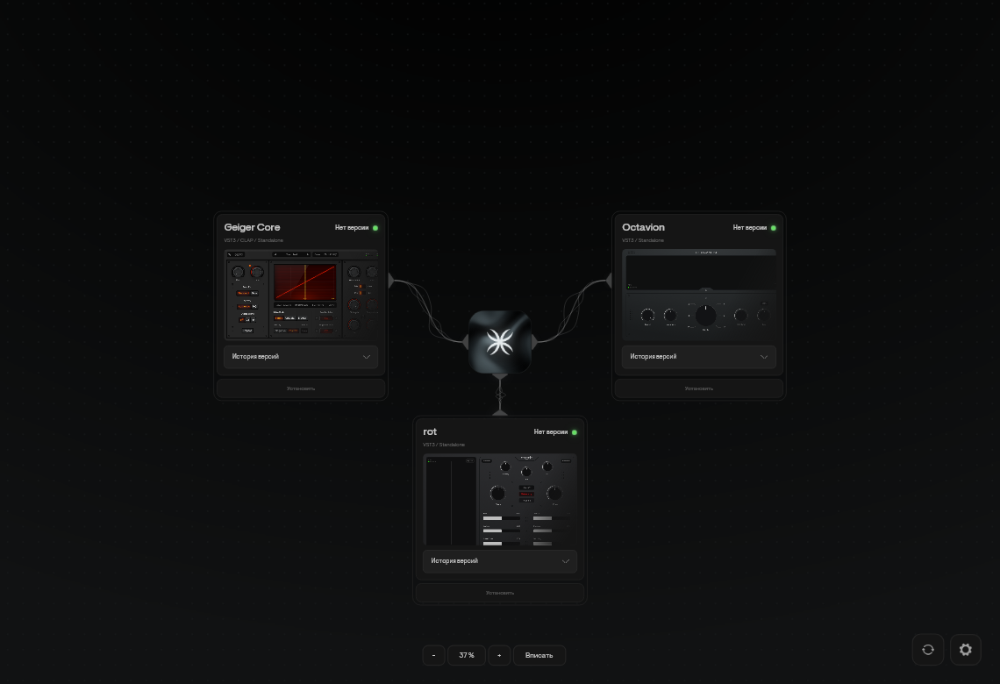
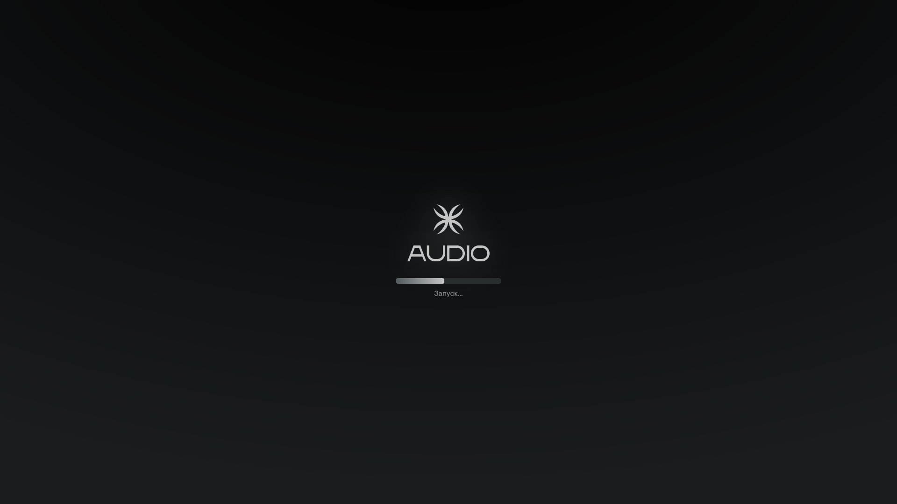

  

<h1 align="center">Rootnot Audio Manager</h1>

Все плагины Rootnot Audio — на одном холсте.

Windows 10 / 11 · x64 · Русский интерфейс

  <a href="https://github.com/therootnot/rootnot-audio-manager/releases">Выпуски</a> ·
  <a href="CHANGELOG.md">История изменений</a> ·
  <a href="https://github.com/therootnot/rootnot-audio-manager/issues/new/choose">Сообщить об ошибке</a> ·
  <a href="https://t.me/therootnot">Rootnot Audio</a> ·
  <a href="README.en.md">English</a>

Rootnot Audio Manager помогает скачивать, устанавливать, обновлять и удалять плагины Rootnot Audio. Карточки плагинов расположены на большом холсте: их можно перемещать, приближать и отдалять.

## Возможности

- **История версий.** Описание изменений и выбор конкретной версии перед установкой.
- **Установка из менеджера.** Загрузка пакета в кэш, проверка целостности, запуск установщика и очистка временных файлов после завершения.
- **Выбор компонентов.** Форматы VST3, CLAP и Standalone, папки установки и дополнительные библиотеки — в зависимости от плагина и версии его установщика.
- **Лицензия перед установкой.** Полный текст соглашения конкретной версии с возможностью принять или отказаться.
- **Обновление и удаление.** Определение установленных плагинов и резервное копирование известных пользовательских пресетов перед изменениями.
- **Живой интерфейс.** Плавные переходы, процедурные связи между карточками и анимированный логотип. Анимацию холста можно отключить в настройках.

## Плагины

| Плагин | Назначение | Форматы |
| --- | --- | --- |
| Octavion | Октавные эффекты и новые текстуры | VST3, Standalone |
| rot | Искажение и характер звука | VST3, Standalone |
| Geiger Core | Цифровая деградация звука | VST3, CLAP, Standalone |

Доступные версии и состав компонентов определяются опубликованными пакетами каждого плагина.

## Скачать

**[Скачать для Windows x64](https://github.com/therootnot/rootnot-audio-manager/releases/latest)**

В разделе последнего выпуска скачайте установщик `.exe`, запустите и следуйте инструкциям. Отдельно устанавливать .NET не требуется. История установщиков доступна в [Releases](https://github.com/therootnot/rootnot-audio-manager/releases).

Настройки и установленные плагины сохраняются при обновлении менеджера.

Для скачивания плагина откройте его карточку, выберите версию, форматы и папки, прочитайте лицензию и подтвердите установку. Для удаления используйте действие в карточке установленного плагина. Перед установкой или обновлением закройте проекты DAW, использующие этот плагин.

## Подключение к сети

При запуске проверяются библиотеки приложения и доступность сети. Без подключения менеджер сообщает об автономном режиме. Локально установленные плагины и встроенный плеер остаются доступны; получение каталога версий, скачивание и обновления требуют интернета.

Установленные плагины работают независимо от открытого окна менеджера. Для просмотра публичных выпусков вход в GitHub не нужен.

Экран запуска

## Поддержка

Нашли проблему — [создайте сообщение об ошибке](https://github.com/therootnot/rootnot-audio-manager/issues/new?template=bug_report.yml). Для предложений есть [отдельная форма](https://github.com/therootnot/rootnot-audio-manager/issues/new?template=feature_request.yml).

Новости Rootnot Audio: [t.me/therootnot](https://t.me/therootnot). Подробнее о сообщениях об ошибках — в [SUPPORT.md](SUPPORT.md).
